<p align="center">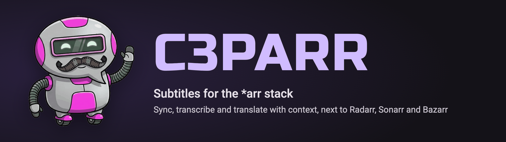</p>

<p align="center">
  <a href="https://github.com/wdonega/c3parr/releases/latest"></a>
  <a href="https://github.com/wdonega/c3parr/pkgs/container/c3parr"></a>
</p>

**c3parr** makes sure every movie and episode in your library has subtitles in the languages you want. It syncs the subtitles you already have, transcribes the audio when there are none, and translates with an LLM that knows the characters, their gender and the tone of the scene.

It works next to **Radarr**, **Sonarr** and **Bazarr**, the way Bazarr does: it reads the library from Radarr and Sonarr and writes the subtitle next to the video. It replaces Lingarr and complements Bazarr: Bazarr downloads subtitles; c3parr makes the ones that are missing.

## What it solves

- **No subtitle in your language.** Old, foreign or niche titles often have a subtitle only in English, or in none. c3parr translates from the best source it finds, or transcribes the audio first.
- **Out-of-sync subtitles.** A subtitle made for another release is shifted or stretched. c3parr re-times it against the audio, or against an embedded subtitle.
- **Literal machine translation.** A line-by-line translation gets the gender wrong ("cansado" or "cansada"?), mixes formal and informal address, and translates names. c3parr builds a *bible* for each title first (characters, gender, formality, glossary from TMDb and the script) and translates scene by scene with it.
- **Mixed-language audio.** Lines spoken in another language are marked, as in "[em árabe] …".

## How it works

For each monitored item, after a wait time (so a download can finish), c3parr decides what is missing and queues only those steps:

1. **Metadata** from TMDb: original language, cast and season/episode.
2. **Main subtitle**, the best source available, in this order:
   1. an embedded text subtitle;
   2. an external subtitle next to the video (Bazarr's or a human one), synced;
   3. a subtitle in a fallback language (`en`, `es`, `fr`…);
   4. a transcription of the audio (ASR).
3. **Translation** of the main subtitle into every target language that is still missing.

The result is written as `<video>.<lang>.c3parr.srt`. When a better subtitle shows up later (Bazarr downloads a human one), c3parr can sync it, make it the main one and regenerate or remove its own translations.

## Features

- **Library from Radarr and Sonarr.** "Sync with Radarr/Sonarr" tasks run every hour, with path mappings and filters (monitored only, tags, series type, season zero), like Bazarr. There are no folders to configure and no webhooks.
- **Transcription (ASR) with whisper.cpp** on CUDA, Vulkan, Metal or the CPU, with VAD (it doesn't hallucinate over music). It can also run on a **separate server**, through an OpenAI-compatible API (whisper.cpp server, speaches, LocalAI) or a whisper-asr-webservice like Bazarr's.
- **Concert subtitles.** For a concert, c3parr separates the voice from the band, finds which songs are played and places the official lyrics where each line is sung (♪), plus what is said between the songs. See [Concert subtitles](#concert-subtitles).
- **LLM translation** with your own server (llama.cpp, Ollama, vLLM) or a cloud provider: **DeepSeek**, **Anthropic**, **Gemini** or **OpenAI**. The reasoning effort for Anthropic and Gemini is configurable.
- **Web UI** in the *arr style:
  - Movies and TV Shows, each item with a Monitored flag;
  - a queue with live progress;
  - System pages: Tasks, Alerts, Logs and Status;
  - Settings with a change counter on Save, plus a test-connection button for every service;
  - in English, Portuguese (Brazil) and Spanish (Mexico).
- **CLI** for single files: `c3parr movie.mkv --dst pt-BR`, or `c3parr "Band - Live.mkv" --show` for a concert.

## Hardware: do you need a GPU?

**Without a real GPU, use a cloud LLM for the translation.** It costs cents per film and gave the best quality in our tests. Transcription runs on the CPU too, only slower.

### Transcription (whisper.cpp, large-v3-turbo, 6 minutes of audio)

| Machine | Accelerator | Time | Per hour of video |
|---|---|---|---|
| i7-13700KF + RTX 5060 Ti | Vulkan | 7.7 s | ~1.3 min |
| MacBook Pro M3 Pro | Metal | 8 s | ~1.3 min |
| AMD BC-250 | Vulkan | 8.7 s | ~1.5 min |
| Jetson Orin Nano Super | CUDA | 11.4 s | ~1.9 min |
| i7-13700KF | CPU | 17 s | ~2.8 min |
| AMD BC-250 | CPU | 60 s | ~10 min |
| Raspberry Pi 5 / RK3588 | CPU | 95 s | ~16 min |
| Intel N150 | CPU | 297 s | ~50 min |

### Translation (21 minutes of a film, 178 lines, EN → pt-BR)

chrF++ is measured against the human pt-BR subtitle; a literal machine translation scores 49.8.

| Model | Where | chrF++ | Time | Cost |
|---|---|---|---|---|
| Gemini 3.8 Flash | cloud | 54.3–55.7 | 172–466 s | cents |
| DeepSeek Flash 4.1 | cloud | 53.6–54.1 | ~77 s | < US$ 0.01 |
| Claude Haiku 5.5 | cloud | 52.7–54.8 | 190–240 s | ~US$ 0.03 |
| translate-gemma-4-sub E2B (3.3 GB) | AMD BC-250 | 53.2 | 66 s | power only |
| Gemma 4 E2B (3.6 GB) | AMD BC-250 | 52.6 | 442 s | power only |
| Qwen3.5-4B (3.9 GB) | AMD BC-250 | 51.4 | 663 s | power only |

Cost and time scale with the number of lines. One hour of a quiet drama is about 2× the table; one hour of a dialogue-heavy series is about 6×.

On an 8 GB board (Jetson Orin Nano), run the transcription **or** an LLM, not both.

## Quick start (Docker)

```yaml
services:
  c3parr:
    image: ghcr.io/wdonega/c3parr:latest  # NVIDIA; for AMD/Intel use :latest-vulkan
    container_name: c3parr
    restart: unless-stopped
    ports:
      - "8484:8484"
    environment:
      PUID: "1000"   # the same user as your Radarr/Sonarr files
      PGID: "1000"
      TZ: America/Sao_Paulo
    volumes:
      - ./c3parr:/config            # database, settings, keys and whisper.cpp models
      - /data/media:/data/media     # the same path Radarr and Sonarr use
    deploy:                         # NVIDIA (needs nvidia-container-toolkit)
      resources:
        reservations:
          devices:
            - driver: nvidia
              count: all
              capabilities: [gpu]
    # Vulkan (AMD/Intel): replace the deploy block with
    # devices:
    #   - /dev/dri:/dev/dri
```

Then open `http://<host>:8484` and follow [Setup, step by step](#setup-step-by-step). Until it is done, **System → Alerts** lists what is still missing.

### Images

Every image is built for **x86 (amd64)** and **ARM (arm64)**; Docker picks the right one.

| Tag | GPU |
|---|---|
| `latest`, `latest-cuda`, `revN`, `revN-cuda`, `1.1.N` | NVIDIA: RTX 20xx–50xx on x86; Jetson Orin, Thor and DGX Spark on ARM |
| `latest-vulkan`, `revN-vulkan`, `1.1.N-vulkan` | AMD, Intel and others through Mesa |

The `cuda` image for x86 carries PyTorch with its CUDA libraries for the [concert subtitles](#concert-subtitles), about 5 GB more on disk; the others carry PyTorch for the CPU.

Both images also run without a GPU: whisper.cpp picks the fastest CPU code for the machine at start. On an **RK3588** (Mali-G610), leave `/dev/dri` out: the Vulkan driver for that GPU fails, and the CPU is faster there anyway.

## Setup, step by step

The screenshots show the interface with an example library.

### 1. Connect Radarr

**Settings → Library → Radarr.** Turn on **Use Radarr**, then fill in the address and port. On the same Docker network it is the container name (`radarr`, `7878`). Get the API key from Radarr → Settings → General. Leave **Path mappings** empty when both see the media at the same path (`/data`).

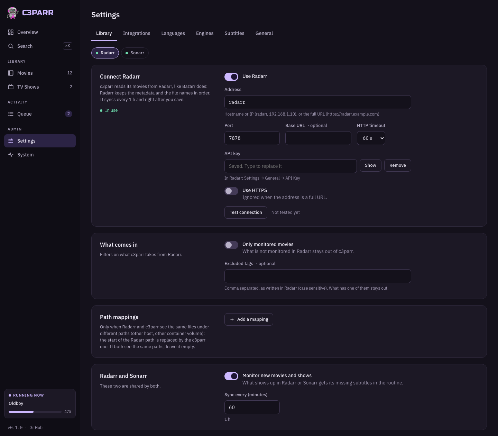

**Test connection** answers next to the button with the Radarr version. A bar with **Save** shows up as soon as something changes; after saving, the *Sync with Radarr* task reads the library right away and then every hour.

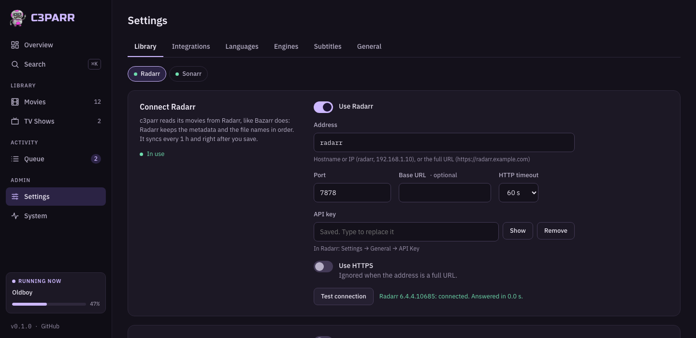

### 2. Connect Sonarr

The same on the **Sonarr** tab (`sonarr`, `8989`). Sonarr has two more filters: series types and season zero.

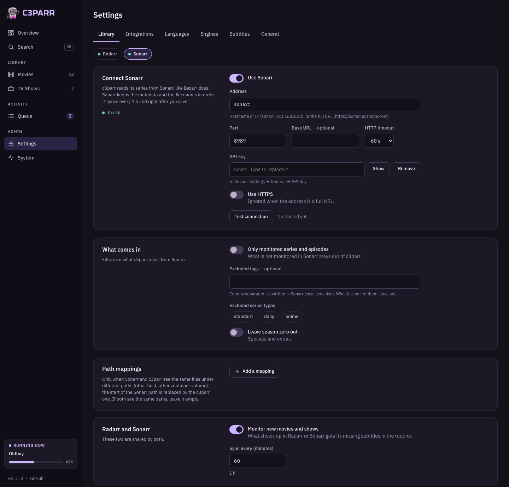

### 3. Pick the translator (LLM)

**Settings → Integrations → Translation model.** Use your own OpenAI-compatible server (llama.cpp, Ollama, vLLM) with its URL and model.

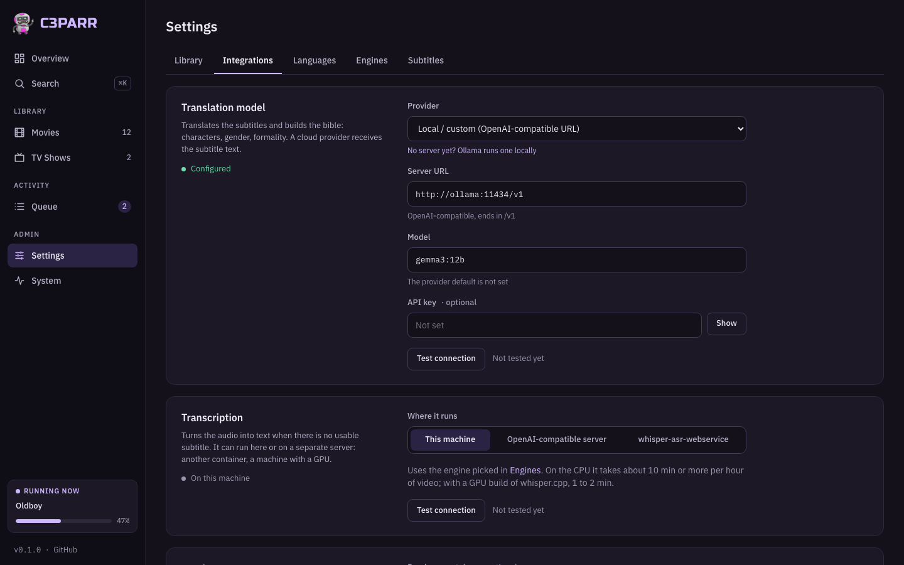

Or pick a cloud provider. The model in use is filled in, the link points to where you get the key, and Anthropic and Gemini also take a reasoning effort (**Low** is cheaper and translated as well in our test). Without a GPU this is the recommended option; see [Hardware](#hardware-do-you-need-a-gpu).

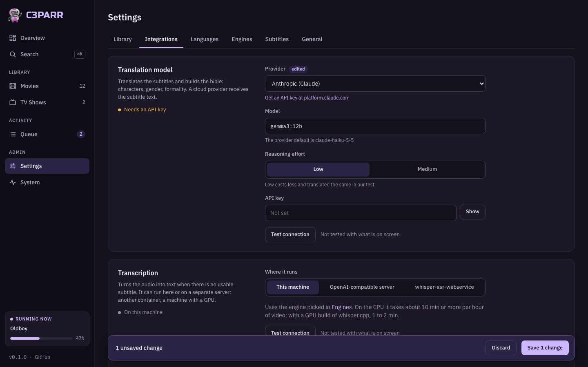

### 4. Pick where the transcription runs

**Settings → Integrations → Transcription.** It is only used when an item has no usable subtitle at all. **This machine** runs whisper.cpp in the container. A **separate server** (another machine with a GPU) works through an OpenAI-compatible API or a whisper-asr-webservice like Bazarr's. TMDb needs nothing: c3parr has its own key.

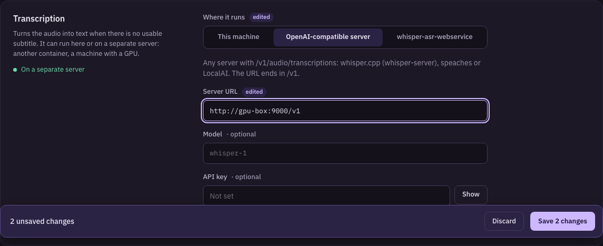

### 5. Choose the languages

**Settings → Languages.** These are the **target languages** every item must have, plus the **fallback languages** used as the main subtitle when the original language has none.

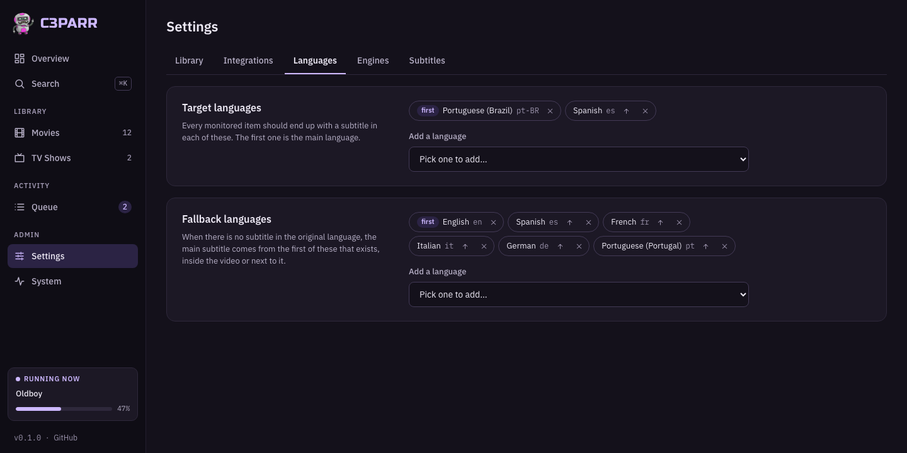

### 6. Decide how subtitles are handled

**Settings → Subtitles.** Here you choose which subtitles count, what happens when a new one shows up, and how long to wait after a download before working on it.

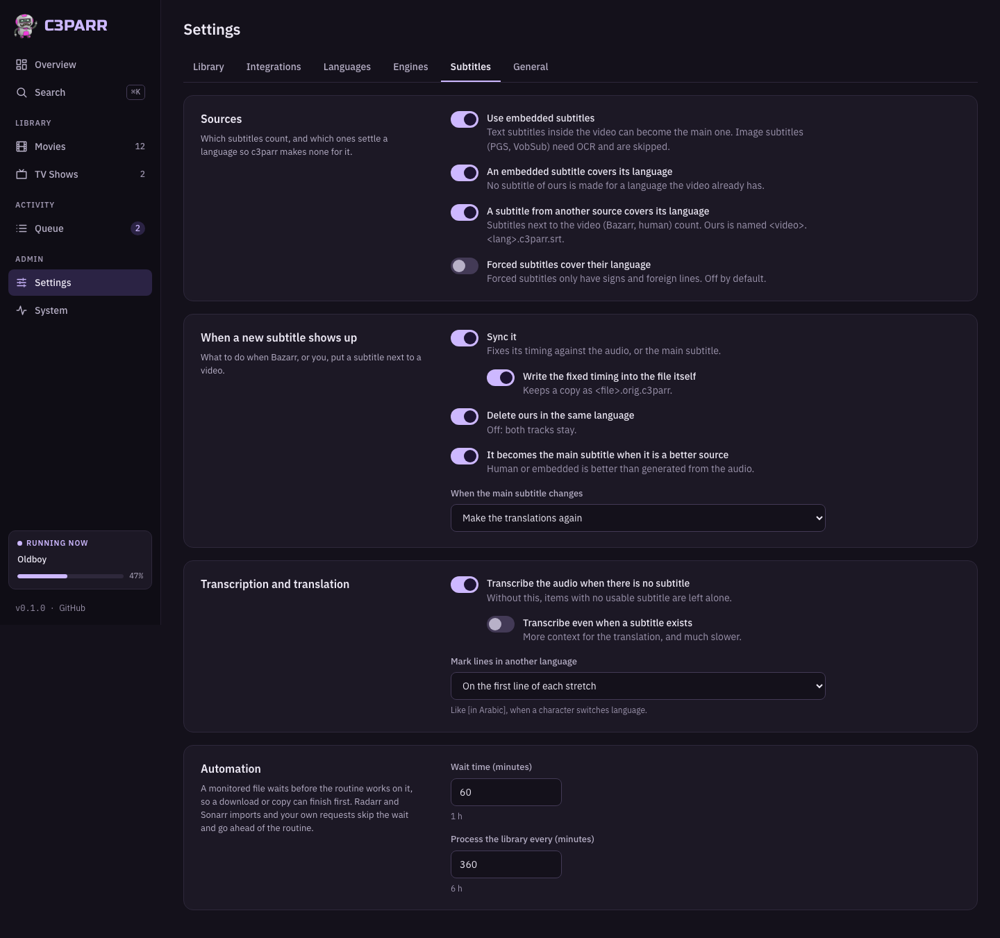

### 7. Watch it work

**Movies** and **TV Shows** show each item with the subtitles it has: inside the video, from another source, made by c3parr, or missing. The button on an item that misses one (**Make pt-BR**) sends it ahead of the hourly routine.

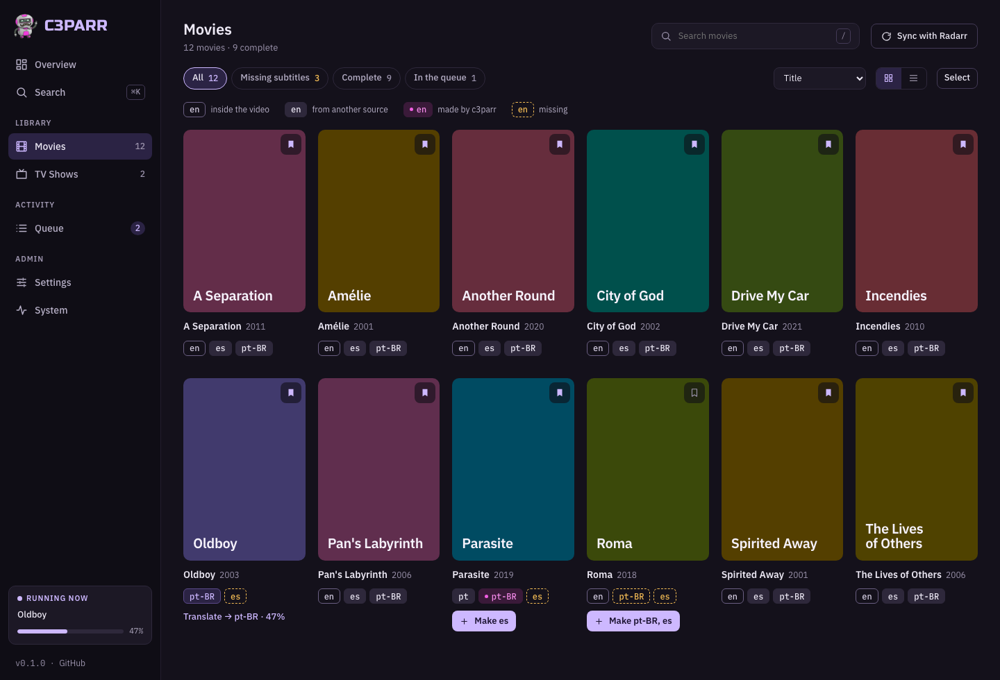

A show opens the seasons that still have work to do.

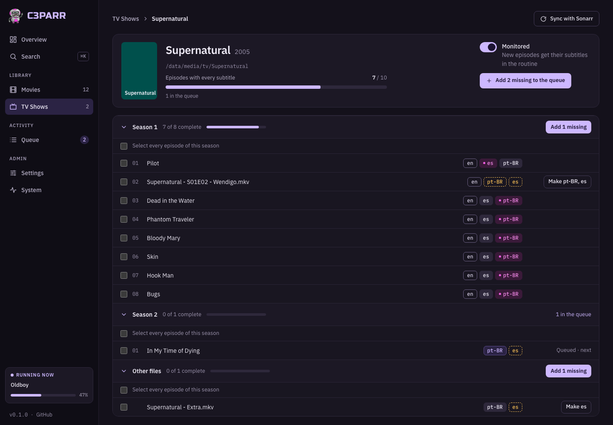

The queue shows what runs now, what comes next in the order it will run, and what finished. Here a movie is being translated to pt-BR, block by block.

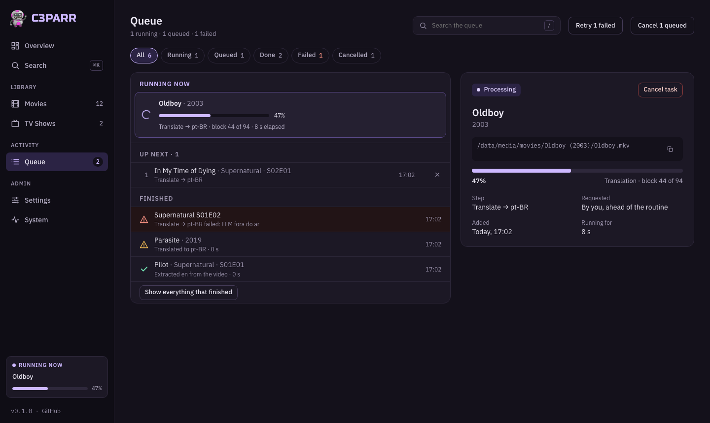

**System → Tasks** lists the routines: the Radarr and Sonarr syncs and the run that decides what each item is missing. The **Overview** sums it all up.

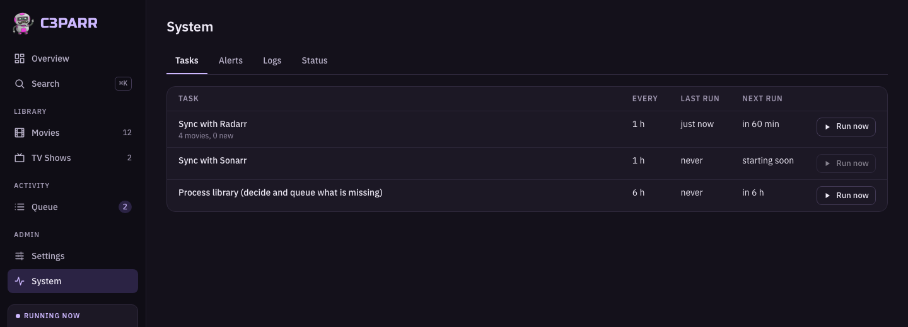
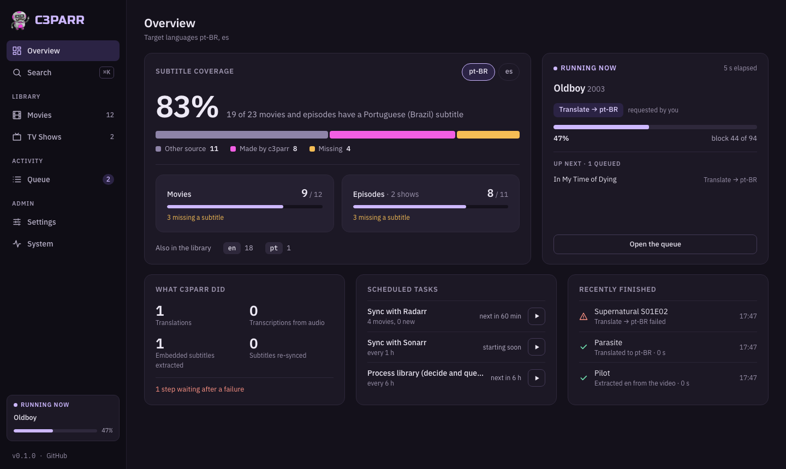

### Concert subtitles

A concert is mostly singing, and Whisper gets singing wrong with full confidence. So for a concert c3parr does something else:

1. It separates the voice from the band (Demucs).
2. It finds the artist from the title and fetches the lyrics of what they had released by the year of the concert (MusicBrainz and LRCLIB).
3. It finds which songs are played and where, and places each lyric line at the instant it is sung (`♪ … ♪`).
4. It keeps a line only with proof: the sound matches it, the transcript heard it, or it sits where the studio recording has it. A chorus that comes back is heard again with the lyrics as a hint, and needs its own proof.
5. It transcribes what is said between the songs, in the language of each stretch.

**Settings → Subtitles → Concerts** turns it on. It is off by default, and then a concert is treated like any film.

- **Concert subtitles**: off, only when you ask for the item, or automatic.
- **Concert folders**: where your concerts are, as c3parr sees them (for example `/data/media/musicvideos`, a second root folder in Radarr). What TMDb clearly says is not a concert is left out even there: a film (a plot genre, or a cast that plays characters), a documentary, a series. Left empty, c3parr guesses from TMDb and only treats an item as a concert when it is sure.
- **Use the official lyrics from the internet**: only the artist name and the song titles leave your machine. Off, the subtitle has only what was heard in the isolated voice.
- **Also publish in the language that is sung**: the lyrics as they are sung, next to the translation into your target languages.
- **Memory for concerts**: the ceiling (automatic, up to 3 GB or up to 2 GB). A concert works in pieces sized to the memory that is free at the time, with a margin: 2 GB free is enough, and it takes the same time. With less than 1.5 GB free the task stops with an alert instead of pushing the machine into swap.
- **Queue the concerts now**: sends every concert in the library to the queue, ahead of the routine. Use it after turning concerts on or changing the folders; concerts that already had a plain subtitle are done again.

What to expect:

- The lyric fitting works for **English** lyrics. In other languages the subtitle keeps what was heard, with the official text only where the transcript matched a lyric line.
- Covers, and songs LRCLIB doesn't have, keep what was heard.
- The transcription has to be whisper.cpp, in the c3parr container or on a [whisper.cpp server](#extra-transcription-on-another-machine): a concert needs two options the other servers don't take.
- Only an **NVIDIA GPU with the `cuda` image on x86** speeds up the voice separation and the lyric fitting. The `vulkan` image and ARM run them on the CPU.
- Memory, measured: the voice separation peaks at 2.1 GB with the smallest pieces (the 2 GB ceiling), 3.1 GB at the 3 GB ceiling and 4.1 GB with the largest; the lyric fitting at 2.3 GB (3.5 GB with the largest windows), of which 1.3 GB is the model file read straight from disk.
- The model files (about 1.3 GB) download on the first concert. **System → Status** shows the speed measured on your machine.

| Per hour of concert | RTX 3060 (`cuda` image) | Apple M3 Pro (CPU; Metal for Whisper) |
|---|---|---|
| Voice separation | 1.7 min | 17 min |
| Transcription of the isolated voice | 1.6 min | 2 min |
| Lyric fitting | 0.6 min | 5.5 min |
| Everything, start to finish | about 5 min | about 27 min |

The "everything" row comes from a two-hour concert: 11 minutes on the RTX 3060, model downloads included.

From the command line: `c3parr "Band - Live.mkv" --show`. Add `--artist "Band"` when the file name doesn't say who plays, `--year 1995` for the year of the concert, and `--no-lyrics` to skip the lookup.

### Behind a reverse proxy

**Settings → General → Host** has what a reverse proxy needs:

- **URL base**: the path c3parr is served under, like `/c3parr`. Empty serves it at the root of the name. It takes effect when you save, with no restart, and c3parr answers with and without it, so it works whether the proxy passes the path as it is or strips the prefix. `C3PARR_URL_BASE` sets it from the compose file.
- **Allowed hosts**: the names c3parr answers to (`c3parr.example.com`). Empty allows all; `localhost` always works, so the container healthcheck is never locked out.
- **Instance name**: shown in the browser tab and as the name of the installed app.

The bind address and port are shown there but come from `C3PARR_HOST` and `C3PARR_PORT`: in Docker, the compose file decides the port. With nginx, for a path:

```nginx
location /c3parr/ {
    proxy_pass http://c3parr:8484;
    proxy_set_header Host $host;
}
```

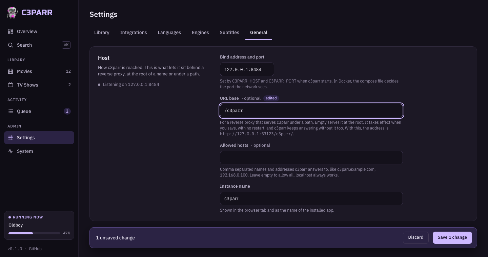

### Install it as an app

The interface is a PWA: on a phone or a desktop browser, use *Install* (Chrome, Edge) or *Add to Home Screen* (Safari). Browsers only offer it over HTTPS, so put c3parr behind your reverse proxy with a certificate.

### Language

The interface speaks English (US), Portuguese (Brazil) and Spanish (Mexico). The first time, it opens in the language of your browser: any Portuguese opens in Portuguese, any Spanish in Spanish, everything else in English. To change it, use the picker at the bottom of the menu (on a phone, in **More**). The choice is saved in that browser, so each person and each device keeps its own.

Logs, error messages that come from other services (Radarr, Sonarr, the LLM) and the summaries of the scheduled tasks stay in English.

## Extra: transcription on another machine

Only needed when c3parr runs on a small box: if its machine already has a good GPU, skip this. Transcription is the only heavy step, and it can run on another machine with a GPU. On a NanoPi M5 (CPU only), a 42-minute episode took 66 minutes; through a Jetson Orin Nano on the network, about 3 minutes, audio upload included.

[`examples/whisper-server`](examples/whisper-server) builds whisper.cpp and serves the OpenAI API c3parr talks to. Like c3parr's image, it has two variants, for x86 and ARM: **cuda** for NVIDIA (the machine needs the driver and the nvidia-container-toolkit) and **vulkan** for AMD, Intel and others through Mesa. On an AMD BC-250 the Vulkan build took 5 minutes and transcribed 6 minutes of audio in 10 s over the network.

1. On the GPU machine, get the example folder:

   ```bash
   git clone --depth 1 https://github.com/wdonega/c3parr.git
   cd c3parr/examples/whisper-server
   ```

   In [`compose.yaml`](examples/whisper-server/compose.yaml), pick the variant. For NVIDIA, set `CUDA_ARCHS` to your GPU only (`86` RTX 30xx, `89` RTX 40xx, `120` RTX 50xx, `87` Jetson Orin…); empty builds all of them and takes much longer. For AMD or Intel, set `VARIANT: vulkan` and swap the `deploy` block for `/dev/dri`, as the comment in the file shows.

   ```yaml
   services:
     whisper:
       build:
         context: .
         args:
           VARIANT: cuda             # or vulkan for AMD/Intel
           CUDA_ARCHS: "89"          # RTX 40xx
       container_name: whisper
       restart: unless-stopped
       environment:
         WHISPER_MODEL: large-v3-turbo-q8_0
       volumes:
         - ./models:/models        # ~900 MB, downloaded on the first start
       ports:
         - "9000:9000"
       deploy:
         resources:
           reservations:
             devices:
               - driver: nvidia
                 count: all
                 capabilities: [gpu]
       # Vulkan (AMD/Intel): replace the deploy block with
       # devices:
       #   - /dev/dri:/dev/dri
   ```

2. Build and start it, from that folder. The build compiles whisper.cpp once (about 5 minutes for Vulkan on a 12-core x86, 25 for CUDA on an 8-core ARM board); the first start downloads the model before port 9000 opens.

   ```bash
   docker compose up -d --build
   docker logs -f whisper     # ready when it prints the model on "CUDA0" or "Vulkan0"
   ```

3. Check it from any machine with a short audio file. The answer is JSON with the text in the original language.

   ```bash
   curl http://<gpu-machine>:9000/v1/audio/transcriptions -F file=@sample.wav
   ```

4. In c3parr, **Settings → Integrations → Transcription**: **Where it runs** = *OpenAI-compatible server*, **Server URL** = `http://<gpu-machine>:9000/v1`, **Model** empty (the server uses the model it started with). **Test connection**, then **Save**. The next transcription in the queue goes to the server.

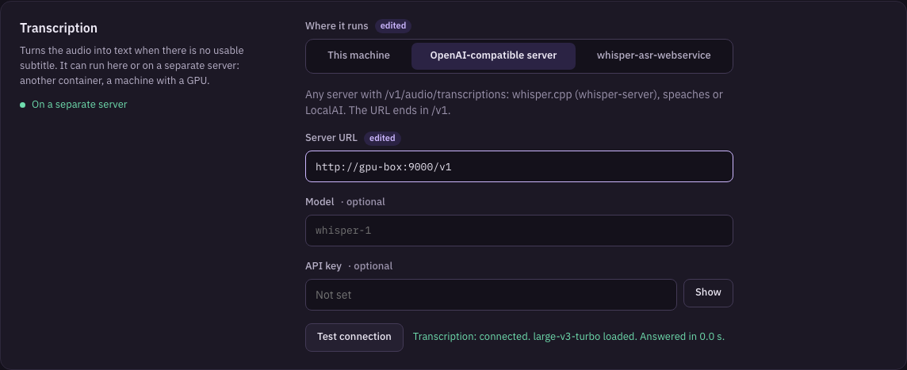

## Development

```bash
uv sync --extra web           # Python 3.12; add --extra concert for concert subtitles (PyTorch)
uv run pytest                 # tests (no models, no network)
uv run ruff check . && uv run mypy src
uv run c3parr-web             # http://127.0.0.1:8484
```

The interface lives in `frontend/` (React, Vite, TypeScript) and talks to the JSON API under `/api/v1` (contract at `/api/docs`). The Docker image builds it; from source, build it once and `c3parr-web` serves it:

```bash
cd frontend
npm ci
npm run build                 # into src/c3parr/web/dist, served by c3parr-web
npm run dev                   # or: hot reload on :5173, talking to c3parr-web on :8484
npm run typecheck && npm run lint && npm test
```

Browser tests drive the built interface against an example library:

```bash
uv run playwright install chromium   # once
uv run pytest -m e2e tests/e2e
```

The texts of the interface live in `frontend/src/i18n`: `en.ts` is the source, and `pt-BR.ts` and `es-MX.ts` must have the same keys (the type checker and `npm test` say when they don't). A sentence the server says gets a code in `MESSAGES` (`src/c3parr/web/service.py`) and a `msg.<code>` key in the three catalogs; `uv run pytest tests/test_i18n_contract.py` checks that both sides match.

The TypeScript types in `frontend/src/api/types.ts` come from the API contract. After changing `src/c3parr/web/schemas.py`, write them again with `C3PARR_UPDATE_GOLDEN=1 uv run pytest tests/test_frontend_types.py`.

For local transcription install whisper.cpp (`brew install whisper.cpp` on a Mac, with Metal).

The extras are optional: `asr` (faster-whisper), `embed` (sentence-transformers) and `concert` (PyTorch, Demucs and torchaudio, for concert subtitles; `concert-cpu` is the same without CUDA, and the two can't be installed together, so `--all-extras` doesn't work). Running from source needs Linux, Windows or a Mac with Apple Silicon.

## License

c3parr is free software under the [GNU Affero General Public License v3.0 or later](LICENSE).
If you run a modified version as a service for other people, you must offer them its source code.


## Acknowledgements

- [whisper.cpp](https://github.com/ggml-org/whisper.cpp) for the transcription.
- [Bazarr](https://www.bazarr.media/), [Radarr](https://radarr.video/) and [Sonarr](https://sonarr.tv/), whose model c3parr follows.
- [BeerCSS](https://www.beercss.com/) and [HTMX](https://htmx.org/) for the UI.
- This product uses the TMDB API but is not endorsed or certified by TMDB. 

