<p align="center">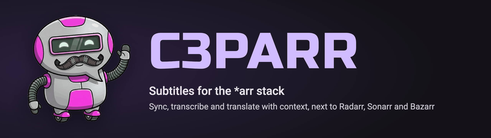</p>

<p align="center">
  <a href="https://github.com/wdonega/c3parr/releases/latest"></a>
  <a href="https://github.com/wdonega/c3parr/pkgs/container/c3parr"></a>
</p>

**c3parr** makes sure every movie and episode in your library has subtitles in the languages you want. It syncs the subtitles you already have, transcribes the audio when there are none, and translates with an LLM that knows the characters, their gender and the tone of the scene.

It works next to **Radarr**, **Sonarr** and **Bazarr**, the way Bazarr does: it reads the library from Radarr and Sonarr and writes the subtitle next to the video. It replaces Lingarr and complements Bazarr: Bazarr downloads subtitles; c3parr makes the ones that are missing.

## What it solves

- **No subtitle in your language.** Old, foreign or niche titles often have a subtitle only in English, or in none. c3parr translates from the best source it finds, or transcribes the audio first.
- **Out-of-sync subtitles.** A subtitle made for another release is shifted or stretched. c3parr re-times it against the audio, or against an embedded subtitle.
- **Literal machine translation.** A line-by-line translation gets the gender wrong ("cansado" or "cansada"?), mixes formal and informal address, and translates names. c3parr builds a *bible* for each title first (characters, gender, formality, glossary from TMDb and the script) and translates scene by scene with it.
- **Mixed-language audio.** Lines spoken in another language are marked, as in "[em árabe] …".

## How it works

For each monitored item, after a wait time (so a download can finish), c3parr decides what is missing and queues only those steps:

1. **Metadata** from TMDb: original language, cast and season/episode.
2. **Main subtitle**, the best source available, in this order:
   1. an embedded text subtitle;
   2. an external subtitle next to the video (Bazarr's or a human one), synced;
   3. a subtitle in a fallback language (`en`, `es`, `fr`…);
   4. a transcription of the audio (ASR).
3. **Translation** of the main subtitle into every target language that is still missing.

The result is written as `<video>.<lang>.c3parr.srt`. When a better subtitle shows up later (Bazarr downloads a human one), c3parr can sync it, make it the main one and regenerate or remove its own translations.

## Features

- **Library from Radarr and Sonarr.** "Sync with Radarr/Sonarr" tasks run every hour, with path mappings and filters (monitored only, tags, series type, season zero), like Bazarr. There are no folders to configure and no webhooks.
- **Transcription (ASR) with whisper.cpp** on CUDA, Vulkan, Metal or the CPU, with VAD (it doesn't hallucinate over music). It can also run on a **separate server**, through an OpenAI-compatible API (whisper.cpp server, speaches, LocalAI) or a whisper-asr-webservice like Bazarr's.
- **LLM translation** with your own server (llama.cpp, Ollama, vLLM) or a cloud provider: **DeepSeek**, **Anthropic**, **Gemini** or **OpenAI**. The reasoning effort for Anthropic and Gemini is configurable.
- **Web UI** in the *arr style:
  - Movies and TV Shows, each item with a Monitored flag;
  - a queue with live progress;
  - System pages: Tasks, Alerts, Logs and Status;
  - Settings with a change counter on Save, plus a test-connection button for every service.
- **CLI** for single files: `c3parr movie.mkv --dst pt-BR`.

## Hardware: do you need a GPU?

**Without a real GPU, use a cloud LLM for the translation.** It costs cents per film and gave the best quality in our tests. Transcription runs on the CPU too, only slower.

### Transcription (whisper.cpp, large-v3-turbo, 6 minutes of audio)

| Machine | Accelerator | Time | Per hour of video |
|---|---|---|---|
| i7-13700KF + RTX 5060 Ti | Vulkan | 7.7 s | ~1.3 min |
| MacBook Pro M3 Pro | Metal | 8 s | ~1.3 min |
| AMD BC-250 | Vulkan | 8.7 s | ~1.5 min |
| Jetson Orin Nano Super | CUDA | 11.4 s | ~1.9 min |
| i7-13700KF | CPU | 17 s | ~2.8 min |
| AMD BC-250 | CPU | 60 s | ~10 min |
| Raspberry Pi 5 / RK3588 | CPU | 95 s | ~16 min |
| Intel N150 | CPU | 297 s | ~50 min |

### Translation (21 minutes of a film, 178 lines, EN → pt-BR)

chrF++ is measured against the human pt-BR subtitle; a literal machine translation scores 49.8.

| Model | Where | chrF++ | Time | Cost |
|---|---|---|---|---|
| Gemini 3.8 Flash | cloud | 54.3–55.7 | 172–466 s | cents |
| DeepSeek Flash 4.1 | cloud | 53.6–54.1 | ~77 s | < US$ 0.01 |
| Claude Haiku 5.5 | cloud | 52.7–54.8 | 190–240 s | ~US$ 0.03 |
| translate-gemma-4-sub E2B (3.3 GB) | AMD BC-250 | 53.2 | 66 s | power only |
| Gemma 4 E2B (3.6 GB) | AMD BC-250 | 52.6 | 442 s | power only |
| Qwen3.5-4B (3.9 GB) | AMD BC-250 | 51.4 | 663 s | power only |

Cost and time scale with the number of lines. One hour of a quiet drama is about 2× the table; one hour of a dialogue-heavy series is about 6×.

On an 8 GB board (Jetson Orin Nano), run the transcription **or** an LLM, not both.

## Quick start (Docker)

```yaml
services:
  c3parr:
    image: ghcr.io/wdonega/c3parr:latest  # NVIDIA; for AMD/Intel use :latest-vulkan
    container_name: c3parr
    restart: unless-stopped
    ports:
      - "8484:8484"
    environment:
      PUID: "1000"   # the same user as your Radarr/Sonarr files
      PGID: "1000"
      TZ: America/Sao_Paulo
    volumes:
      - ./c3parr:/config            # database, settings, keys and whisper.cpp models
      - /data/media:/data/media     # the same path Radarr and Sonarr use
    deploy:                         # NVIDIA (needs nvidia-container-toolkit)
      resources:
        reservations:
          devices:
            - driver: nvidia
              count: all
              capabilities: [gpu]
    # Vulkan (AMD/Intel): replace the deploy block with
    # devices:
    #   - /dev/dri:/dev/dri
```

Then open `http://<host>:8484` and follow [Setup, step by step](#setup-step-by-step). Until it is done, **System → Alerts** lists what is still missing.

### Images

Every image is built for **x86 (amd64)** and **ARM (arm64)**; Docker picks the right one.

| Tag | GPU |
|---|---|
| `latest`, `latest-cuda`, `revN`, `revN-cuda`, `1.0.N` | NVIDIA: RTX 20xx–50xx on x86; Jetson Orin, Thor and DGX Spark on ARM |
| `latest-vulkan`, `revN-vulkan`, `1.0.N-vulkan` | AMD, Intel and others through Mesa |

Both images also run without a GPU: whisper.cpp picks the fastest CPU code for the machine at start. On an **RK3588** (Mali-G610), leave `/dev/dri` out: the Vulkan driver for that GPU fails, and the CPU is faster there anyway.

## Setup, step by step

The screenshots come from a real install next to Radarr, Sonarr, Bazarr and Jellyfin.

### 1. Connect Radarr

**Settings → Library → Radarr.** Turn on **Enabled**, then fill in the address and port. On the same Docker network it is the container name (`radarr`, `7878`). Get the API key from Radarr → Settings → General. Leave **Path Mappings** empty when both see the media at the same path (`/data`).

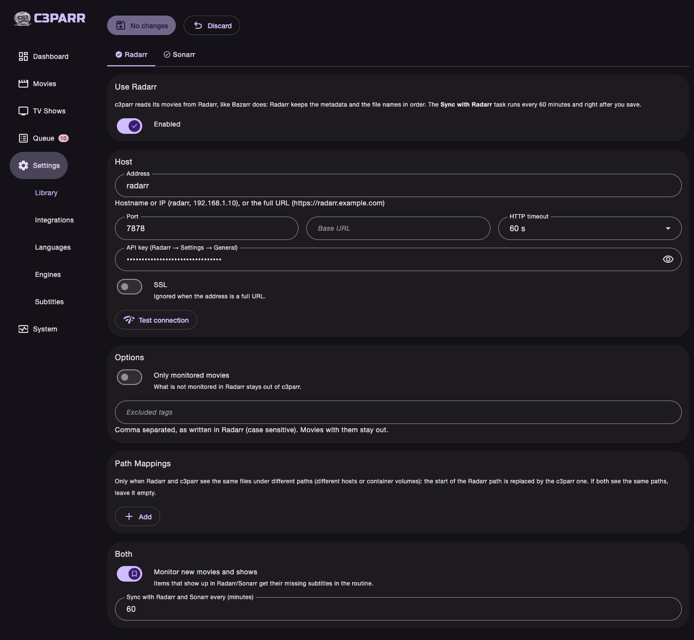

**Test connection** answers with the Radarr version. After **Save**, the *Sync with Radarr* task reads the library right away and then every hour.

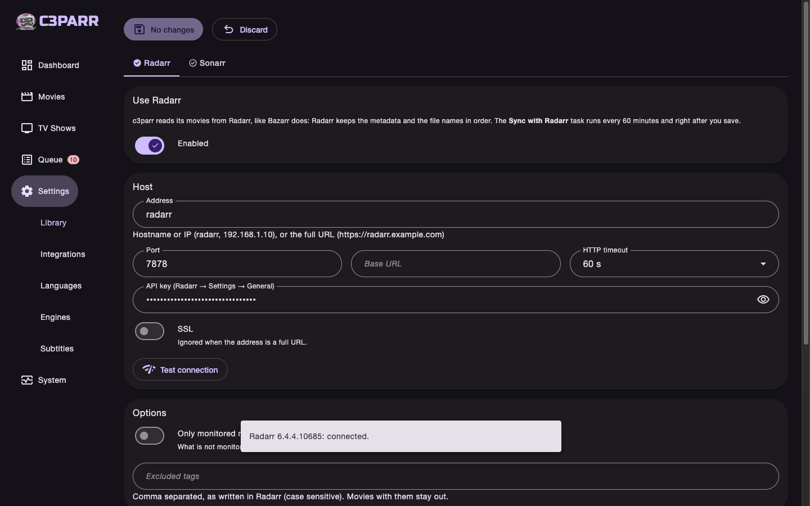

### 2. Connect Sonarr

The same on the **Sonarr** tab (`sonarr`, `8989`). Sonarr has two more filters: series types and season zero.

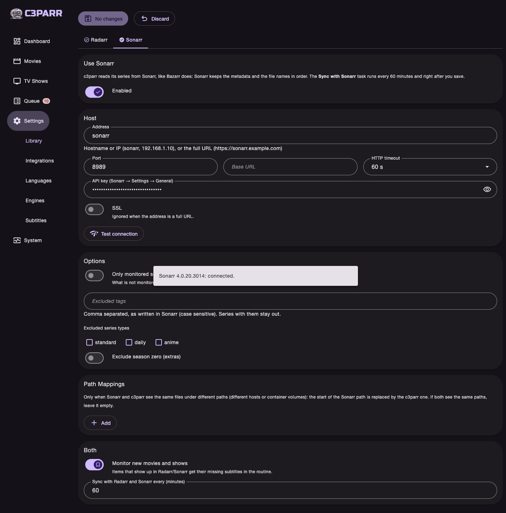

### 3. Pick the translator (LLM)

**Settings → Integrations → LLM.** Use your own OpenAI-compatible server (llama.cpp, Ollama, vLLM) with its URL and model.

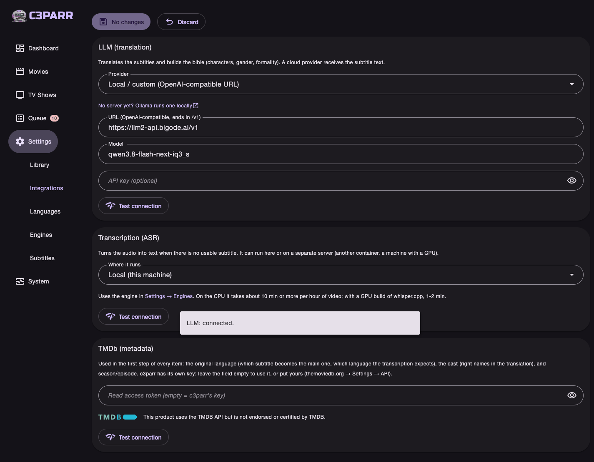

Or pick a cloud provider. The model in use is filled in, the link points to where you get the key, and Anthropic and Gemini also take a reasoning effort (**Low** is cheaper and translated as well in our test). Without a GPU this is the recommended option; see [Hardware](#hardware-do-you-need-a-gpu).

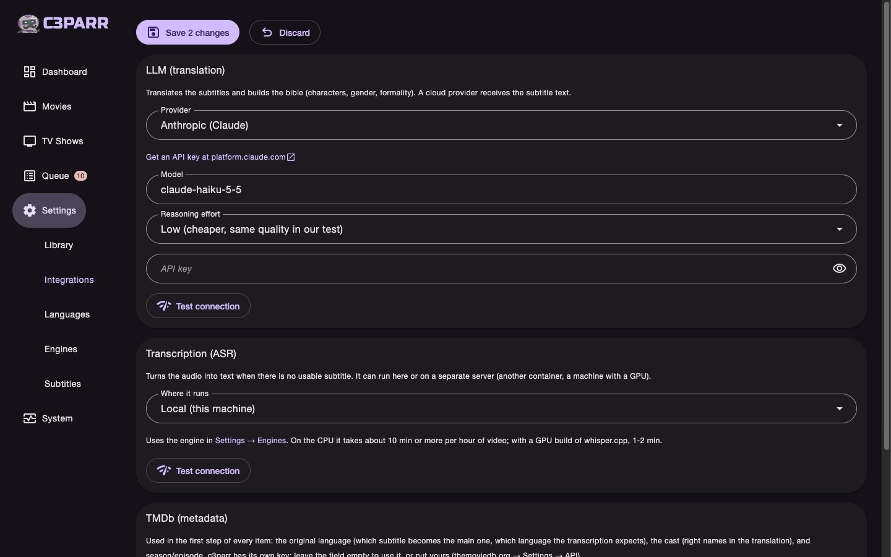

### 4. Pick where the transcription runs

**Settings → Integrations → Transcription.** It is only used when an item has no usable subtitle at all. **Local** runs whisper.cpp in the container. A **separate server** (another machine with a GPU) works through an OpenAI-compatible API or a whisper-asr-webservice like Bazarr's. TMDb needs nothing: c3parr has its own key.

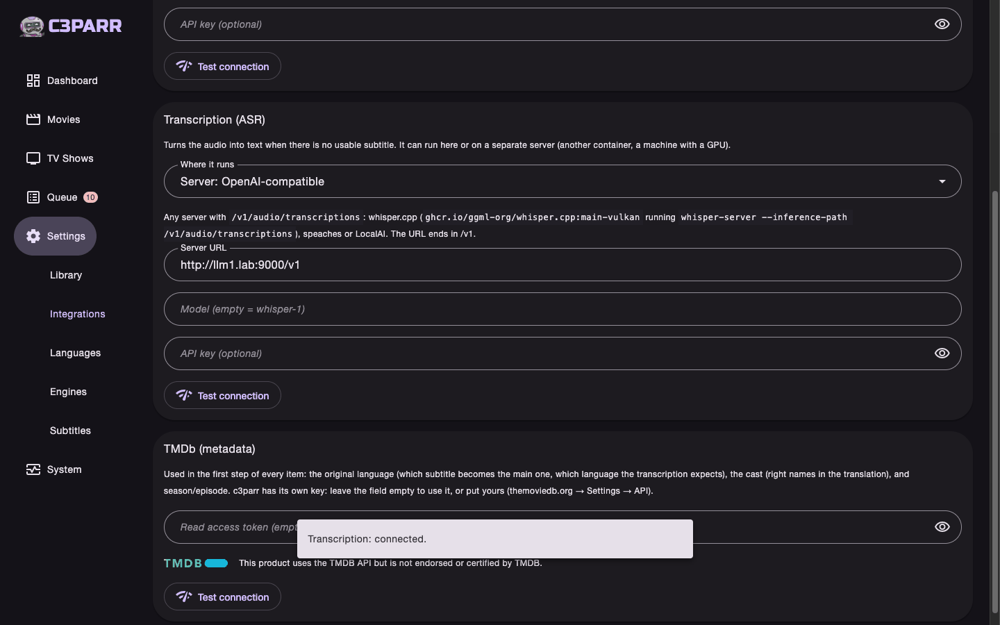

### 5. Choose the languages

**Settings → Languages.** These are the **target languages** every item must have, plus the **fallback languages** used as the main subtitle when the original language has none.

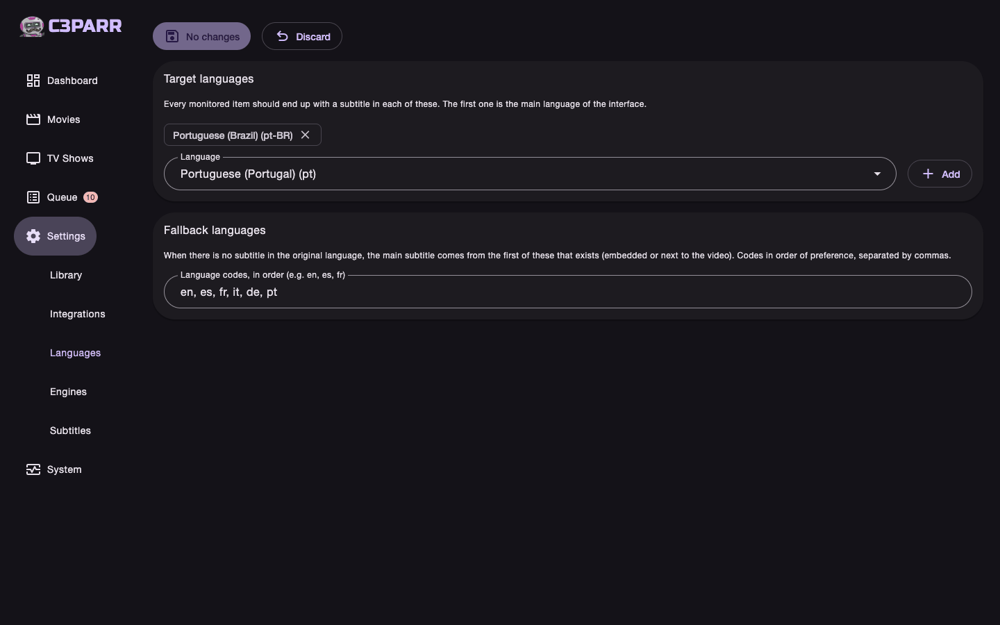

### 6. Decide how subtitles are handled

**Settings → Subtitles.** Here you choose which subtitles count, what happens when a new one shows up, and how long to wait after a download before working on it.

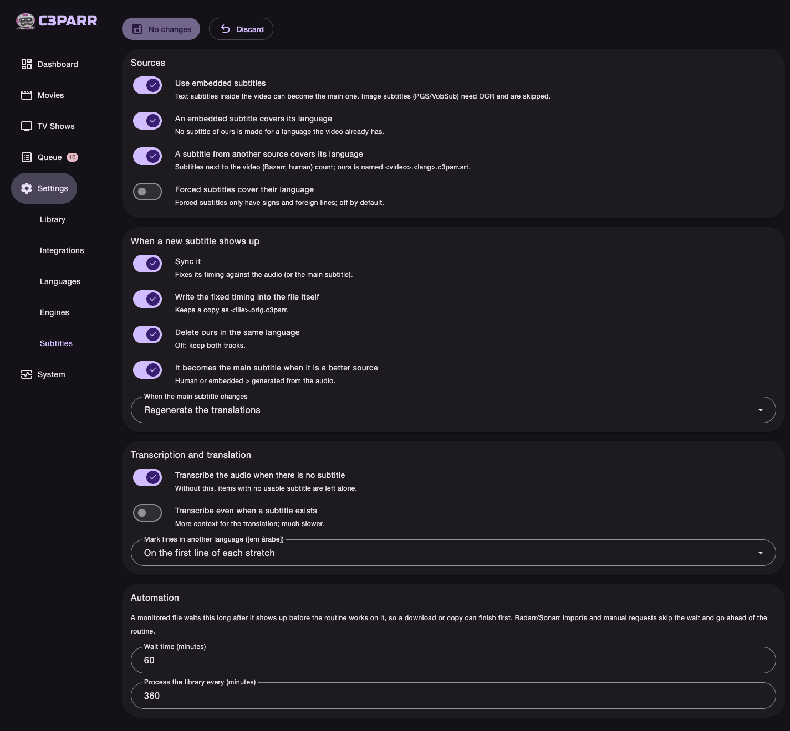

### 7. Watch it work

Each episode shows the subtitles it has. **Add to queue** sends it ahead of the hourly routine.

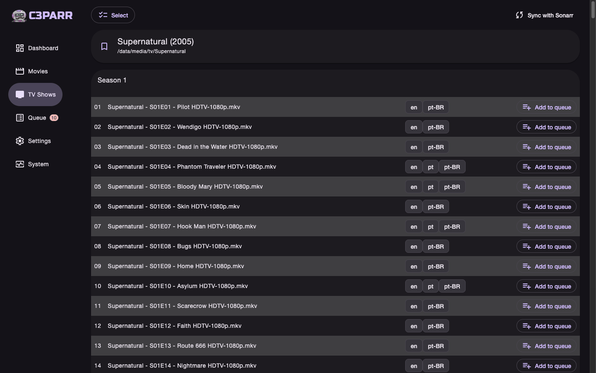

The queue shows each step live: here the English subtitle was extracted from the video and is being translated to pt-BR, block by block.

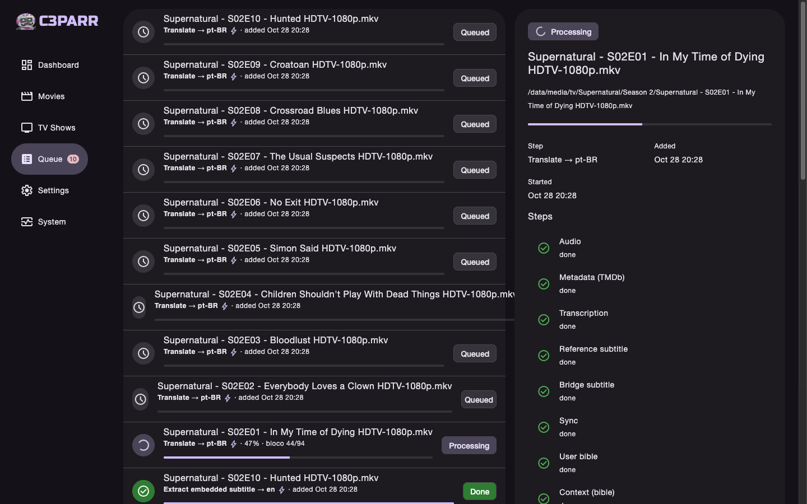

**System → Tasks** lists the routines: the Radarr and Sonarr syncs and the run that decides what each item is missing. The **Dashboard** sums it all up.

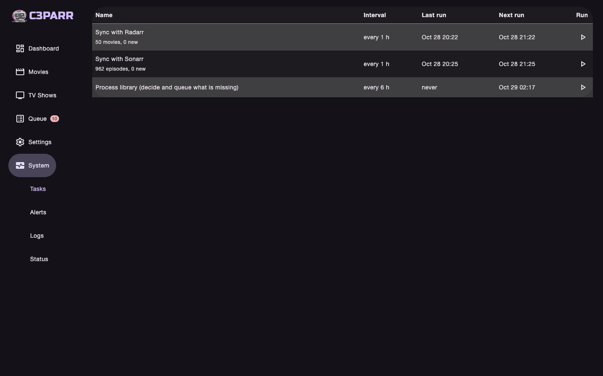
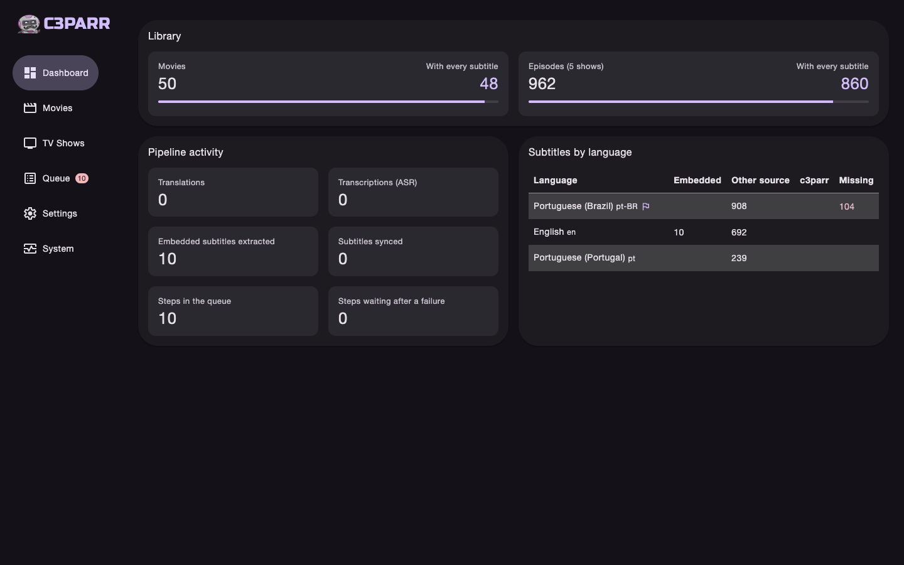

## Extra: transcription on another machine

Only needed when c3parr runs on a small box: if its machine already has a good GPU, skip this. Transcription is the only heavy step, and it can run on another machine with a GPU. On a NanoPi M5 (CPU only), a 42-minute episode took 66 minutes; through a Jetson Orin Nano on the network, about 3 minutes, audio upload included.

[`examples/whisper-server`](examples/whisper-server) builds whisper.cpp and serves the OpenAI API c3parr talks to. Like c3parr's image, it has two variants, for x86 and ARM: **cuda** for NVIDIA (the machine needs the driver and the nvidia-container-toolkit) and **vulkan** for AMD, Intel and others through Mesa. On an AMD BC-250 the Vulkan build took 5 minutes and transcribed 6 minutes of audio in 10 s over the network.

1. On the GPU machine, get the example folder:

   ```bash
   git clone --depth 1 https://github.com/wdonega/c3parr.git
   cd c3parr/examples/whisper-server
   ```

   In [`compose.yaml`](examples/whisper-server/compose.yaml), pick the variant. For NVIDIA, set `CUDA_ARCHS` to your GPU only (`86` RTX 30xx, `89` RTX 40xx, `120` RTX 50xx, `87` Jetson Orin…); empty builds all of them and takes much longer. For AMD or Intel, set `VARIANT: vulkan` and swap the `deploy` block for `/dev/dri`, as the comment in the file shows.

   ```yaml
   services:
     whisper:
       build:
         context: .
         args:
           VARIANT: cuda             # or vulkan for AMD/Intel
           CUDA_ARCHS: "89"          # RTX 40xx
       container_name: whisper
       restart: unless-stopped
       environment:
         WHISPER_MODEL: large-v3-turbo-q8_0
       volumes:
         - ./models:/models        # ~900 MB, downloaded on the first start
       ports:
         - "9000:9000"
       deploy:
         resources:
           reservations:
             devices:
               - driver: nvidia
                 count: all
                 capabilities: [gpu]
       # Vulkan (AMD/Intel): replace the deploy block with
       # devices:
       #   - /dev/dri:/dev/dri
   ```

2. Build and start it, from that folder. The build compiles whisper.cpp once (about 5 minutes for Vulkan on a 12-core x86, 25 for CUDA on an 8-core ARM board); the first start downloads the model before port 9000 opens.

   ```bash
   docker compose up -d --build
   docker logs -f whisper     # ready when it prints the model on "CUDA0" or "Vulkan0"
   ```

3. Check it from any machine with a short audio file. The answer is JSON with the text in the original language.

   ```bash
   curl http://<gpu-machine>:9000/v1/audio/transcriptions -F file=@sample.wav
   ```

4. In c3parr, **Settings → Integrations → Transcription**: **Where it runs** = *Server: OpenAI-compatible*, **Server URL** = `http://<gpu-machine>:9000/v1`, **Model** empty (the server uses the model it started with). **Test connection**, then **Save**. The next transcription in the queue goes to the server.

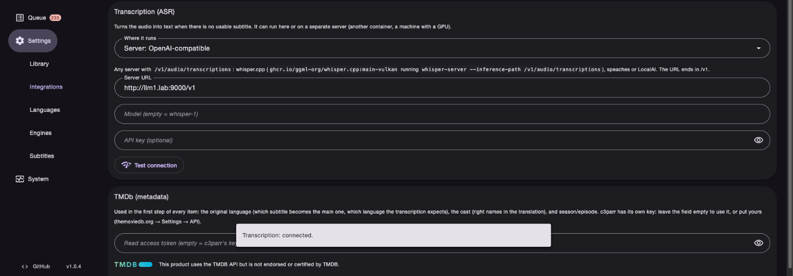

## Development

```bash
uv sync --all-extras          # Python 3.12
uv run pytest                 # tests (no models, no network)
uv run ruff check . && uv run mypy src
uv run c3parr-web             # http://127.0.0.1:8484
```

For local transcription install whisper.cpp (`brew install whisper.cpp` on a Mac, with Metal).

## License

c3parr is free software under the [GNU Affero General Public License v3.0 or later](LICENSE).
If you run a modified version as a service for other people, you must offer them its source code.


## Acknowledgements

- [whisper.cpp](https://github.com/ggml-org/whisper.cpp) for the transcription.
- [Bazarr](https://www.bazarr.media/), [Radarr](https://radarr.video/) and [Sonarr](https://sonarr.tv/), whose model c3parr follows.
- [BeerCSS](https://www.beercss.com/) and [HTMX](https://htmx.org/) for the UI.
- This product uses the TMDB API but is not endorsed or certified by TMDB. 

